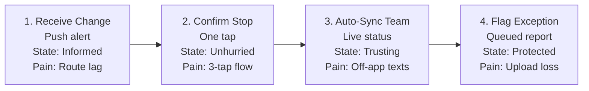

# Future State Journey: Delivery Driver (RouteLogic Velocity)

## Context

- **Persona:** A three-year delivery driver who completes dozens of stops a day, often in bad weather with his hands full (UXR-01).
- **Goal:** Confirm a delivery and receive route changes quickly, with minimal interaction with the app.
- **Friction:** Marking a stop delivered takes three taps across three screens (BUG-2055), so he texts his dispatcher instead.
- **Strategy:** Reclaim operational simplicity by stripping away legacy noise and ensuring the tool is the fastest for everyday work.
- **Value prop check:** High-stakes threat. Systemic problem. Removes the identified obstacle.

---

## Visual Timeline



Plain-text fallback:

```
[1 Receive Change] --> [2 Confirm Stop] --> [3 Auto-Sync Team] --> [4 Flag Exception]
   Push alert            One tap              Live status           Queued report
   Informed              Unhurried            Trusting              Protected
   Route lag             3-tap flow           Off-app texts         Upload loss
```

---

## The 4 Stages

### 1. Receive Change
- **User Action:** Glances at push alert on route change -> acts on the current route immediately.
- **Internal State:** Informed without calling -> trusts the app over WhatsApp.
- **Pain Point Addressed:** 8-15 minute reassignment lag, no push (BUG-2044) -> no wrong turns.

### 2. Confirm Stop
- **User Action:** Taps one large button at the doorstep -> delivery logged, one hand stays free.
- **Internal State:** Unhurried in the rain -> no temptation to text the dispatcher.
- **Pain Point Addressed:** Three taps across three screens (BUG-2055) -> one tap.

### 3. Auto-Sync Team
- **User Action:** Moves to the next stop -> app notifies dispatcher and updates the tracker automatically.
- **Internal State:** Trusting the record -> no follow-up texts or calls.
- **Pain Point Addressed:** Off-app status texts, 20-60 minute board lag (BUG-2072) -> one live record.

### 4. Flag Exception
- **User Action:** Reports a failed delivery or photo issue in the thread -> queued, retried automatically.
- **Internal State:** Protected, not guessing -> clear confirmation replaces repeated retakes.
- **Pain Point Addressed:** Silent ~35% photo failures (BUG-2061), buried failure reporting (UXR-08) -> visible and retried.

---

## 3 Competitive Advantages Over the Manual Workaround

1. **Speed:** One tap replaces typing a message -> faster than texting, even with a wet hand.
2. **Single source of truth:** Taps feed the platform directly -> dispatchers stop transcribing messages into the board.
3. **Accountability:** Timestamped, confirmed, retried records -> disputes resolved without digging through scattered texts.

---

## Design Note

To honor the strategy of stripping away legacy noise, stages 2 and 4 should live on the existing core screen, not in a new chat screen. Otherwise the initiative recreates the buried-actions problem (BUG-2079) it is meant to fix.
